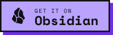
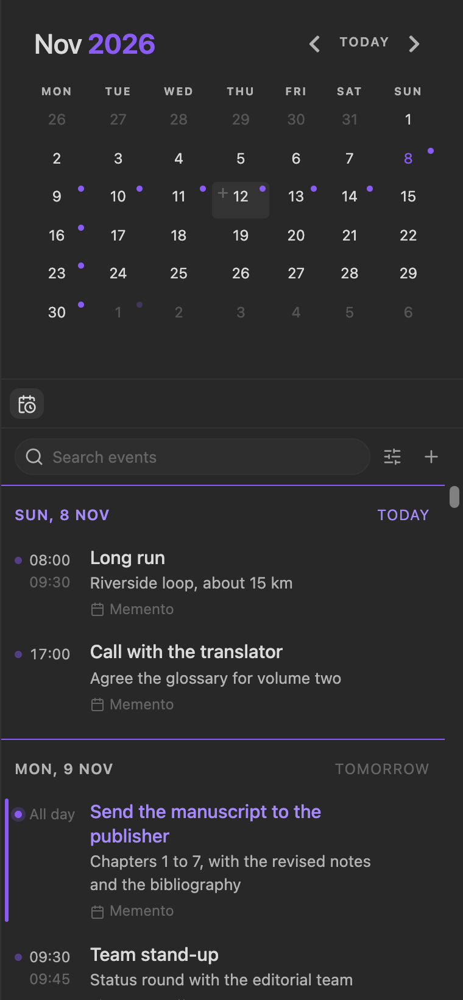
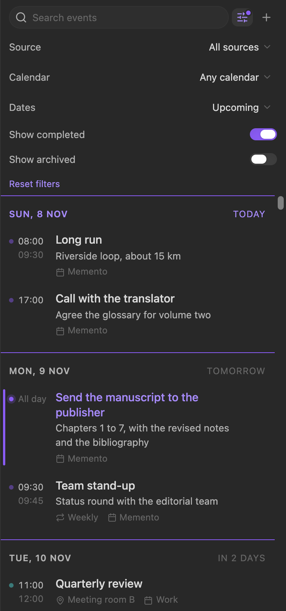
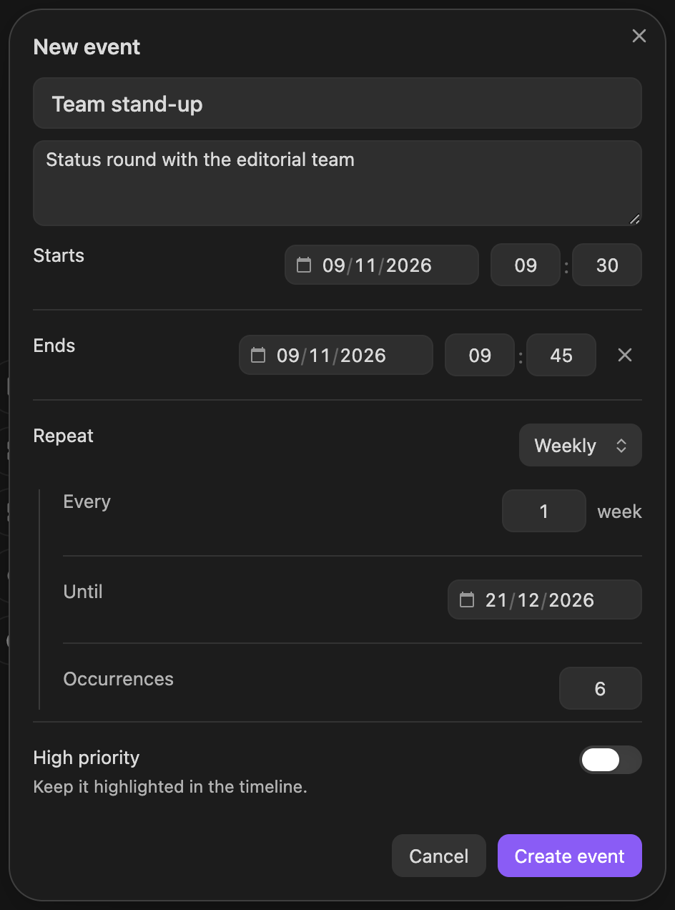
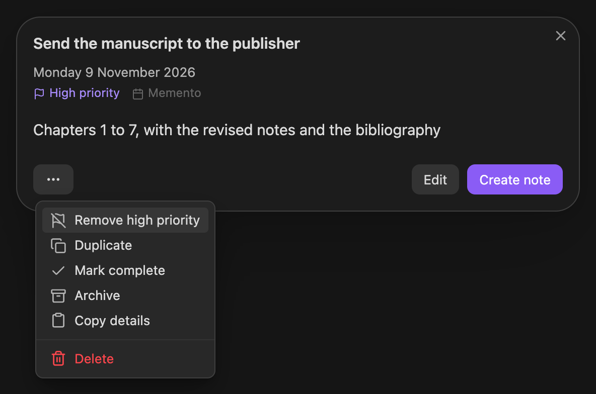
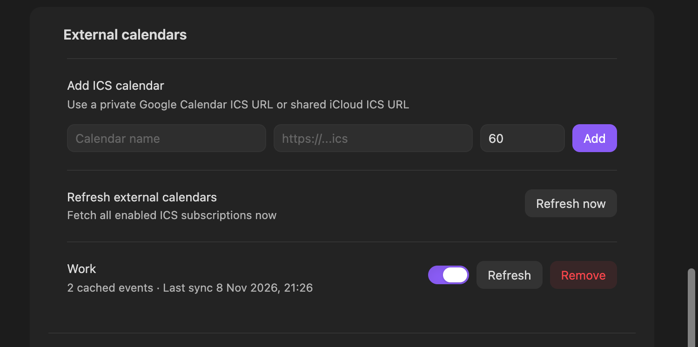
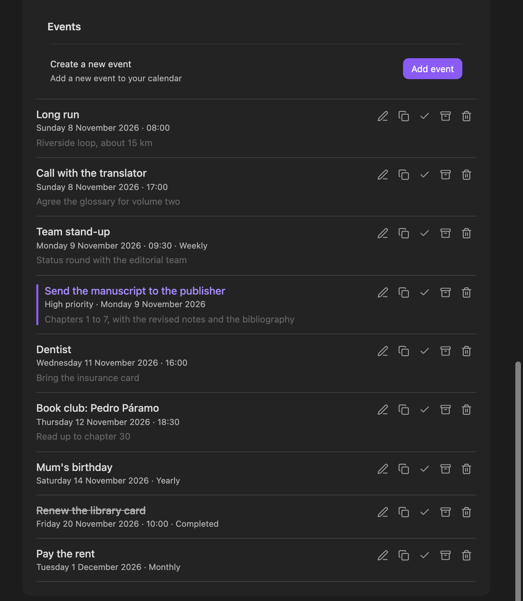
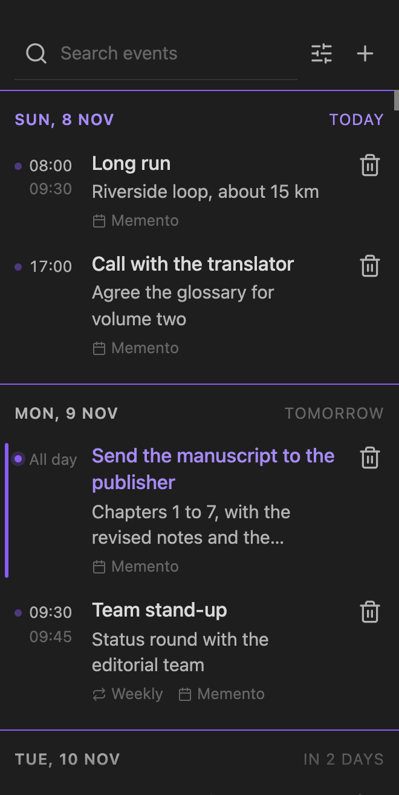

<h1 align="center">Memento</h1>

<p align="center">Events for Obsidian, in a quiet timeline beside your notes.</p>

<p align="center"><a href="https://community.obsidian.md/plugins/memento"></a></p>

<p align="center"></p>

Memento keeps one-time and recurring events in your vault and shows them in a timeline in the sidebar, grouped by day. Days with events get a dot in the [Calendar](https://github.com/liamcain/obsidian-calendar-plugin) plugin, read-only ICS calendars from Google or iCloud sit alongside your own events, and any event can open a note of its own.

Memento draws everything with your theme's colours and fonts. The screenshots show Obsidian's default dark theme.

## Contents

- [The timeline](#the-timeline)
- [Creating events](#creating-events)
- [Working with an event](#working-with-an-event)
- [High priority](#high-priority)
- [The Calendar plugin](#the-calendar-plugin)
- [Event notes](#event-notes)
- [External calendars](#external-calendars)
- [Pending count](#pending-count)
- [Settings](#settings)
- [Commands](#commands)
- [Installation](#installation)
- [Support](#support)

## The timeline

Open it from the calendar-clock icon in the ribbon or with the command **Open event timeline**. Each day starts with a line in the accent colour, the date on the left and how far away it is on the right, and today is set in the accent colour. Under each day:

- The time comes first, with the end time below it when the event has one, or "All day".
- Then the title, and up to two lines of notes.
- A last quiet line shows how the event repeats, where it takes place, and which calendar it comes from. The calendar is named only when you have more than one.
- A dot in the calendar's colour sits before the time and lights up when you point at the event.
- The trash icon on the right deletes the event, after asking first. On an external event it hides the event instead. It shows when you point at the event; on phones and tablets it is always there.

<p align="center"></p>

The search box at the top looks through titles, notes and places as you type. The sliders button opens the filters:

| Filter | Choices |
| --- | --- |
| Source | All sources, Memento only, External only |
| Calendar | Any calendar, Memento, or one of your ICS calendars |
| Dates | Upcoming (the next two years), Next 7 days, Next month, All (past events included) |
| Show completed | Off by default |
| Show archived | Off by default |

While a filter is on, the sliders button has a dot, so a filtered list is never mistaken for an empty one. **Reset filters** puts them all back. The timeline shows 200 events at a time; **Show 200 more** at the bottom loads the next ones.

## Creating events

- In the Calendar plugin, point at a day and click the **+** in its corner, or right-click the day and choose **Create event**.
- In the timeline, click **+** next to the search box.
- From the command palette: **Create a new event**, or **Create event for today**.
- In Settings → Memento → Events, click **Add event**.

<p align="center"></p>

The dialog asks only for what most events need: a title, notes, and when it starts. **Add end** adds an end date and time; the × beside them removes them again. Choose how the event repeats (daily, weekly, monthly or yearly) and the details appear underneath:

- **Every**: 1 for every week, 2 for every other week, and so on.
- **Until**: the last date it can happen.
- **Occurrences**: how many times it happens in all.

Leave Until and Occurrences empty for an event that repeats for good. Press Enter to save from anywhere but the notes box.

## Working with an event

Click an event in the timeline to open it.

<p align="center"></p>

- **Create note**, or **Open note** once it exists, opens the event's own note (see [Event notes](#event-notes)).
- **Edit** opens the event in the same dialog as a new one, with a Status field added (Active, Completed or Archived).
- The **…** menu holds the rest: Mark high priority, Duplicate, Mark complete, Archive, Copy details, and Delete, which asks before it deletes.

Keys while the dialog is open: <kbd>E</kbd> edit, <kbd>N</kbd> open or create the note, <kbd>D</kbd> duplicate, <kbd>A</kbd> archive.

Events from an ICS calendar are read-only. Their dialog offers **Import**, which copies the event into Memento as one you can edit, and **Hide from timeline**.

Completed and archived events leave the timeline unless you turn on Show completed or Show archived. A completed event is struck through.

## High priority

Mark an event high priority with the switch in its dialog or from the **…** menu. In the timeline it keeps a slim bar in the accent colour on its left edge, and its title and dot stay in the accent colour, so it stands out from everything around it at any time. The settings list marks it the same way. **Remove high priority** in the same menu clears it.

## The Calendar plugin

With the [Calendar](https://github.com/liamcain/obsidian-calendar-plugin) plugin installed, Memento adds to its month view:

- a small dot in the corner of every day that has an event, including repeats and ICS events;
- a faint **+** in the corner of the day under the pointer, which creates an event on that day;
- **Create event** in the menu you get by right-clicking a day, and **Open event timeline** when there are events.

Memento works without the Calendar plugin too; only these marks need it.

## Event notes

**Create note** makes a note for that occurrence of the event, named `YYYY-MM-DD - Title.md`, in the folder set in the settings (the vault root when it is empty), and opens it. The note starts with these properties:

```yaml
---
Title: "Send the manuscript to the publisher"
Date: 2026-11-09
Context: "Chapters 1 to 7, with the revised notes and the bibliography"
Source: "Memento"
---
```

Events with a time get it in `Date` (`2026-11-09 09:30`), ICS events with a place get `Location`, and the property names can be in Spanish instead (`Título`, `Fecha`, `Contexto`, `Fuente`, `Ubicación`). Each occurrence of a repeating event gets its own note. Memento remembers which note belongs to which occurrence, and opening it again from the event refreshes the properties.

## External calendars

Memento can show read-only calendars from anything that publishes an ICS address. In Settings → Memento → External calendars, enter a name, the ICS address and how often to refresh it in minutes, then click **Add**.

<p align="center"></p>

- **Google Calendar**: in the calendar's settings, under Integrate calendar, copy the secret address in iCal format.
- **iCloud**: share the calendar as a public calendar and copy its link. If the link starts with `webcal://`, change that to `https://`.

Memento keeps a copy of each calendar's events, so they show even when you are offline, and refreshes it on the interval you set. **Refresh now** fetches every calendar at once. Each calendar has its own switch, **Refresh** and **Remove**, and shows how many events it holds and when it was last fetched.

## Pending count

Memento can show how many events are still ahead of you:

- in the status bar, as a calendar icon and a number (desktop only); click it to open the timeline;
- as a badge on the ribbon icon, on desktop and mobile.

Pointing at the status bar count lists the next few events, and the ribbon icon names the number. In the settings you choose how far ahead the count looks (today, the next 7 days, the next 30 days, or everything upcoming) and whether it includes overdue one-time events.

## Settings

<p align="center"></p>

| Setting | What it does |
| --- | --- |
| Open timeline on startup | Opens the timeline every time Obsidian starts. When off, Obsidian restores it only if you left it open. |
| Show pending count in status bar | Calendar icon and count in the status bar. Desktop only. |
| Show pending count on ribbon icon | Count as a badge on the ribbon icon. Desktop and mobile. |
| Pending count covers | Today only, Next 7 days, Next 30 days or All upcoming. |
| Include overdue events | Also counts one-time events whose date or time has passed and that are still active. |
| Timeline view mode | All upcoming events, or only the next month. |
| Show past events | Lists past one-time events in the Events list in the settings. |
| Frontmatter language | English or Spanish property names in event notes. |
| Event notes folder | Where event notes go. Empty means the vault root. |
| External calendars | Add, switch on or off, refresh and remove ICS calendars. |
| Data management | **Export JSON** saves your events and calendar list to a file in the vault root. **Import JSON** adds the events from such a file, pasted into the box; events with an id you already have get a new one. |
| Events | Every Memento event, with buttons to edit, duplicate, complete, archive or delete it. |

## Commands

| Command | |
| --- | --- |
| Create a new event | Opens the New event dialog, set to today. |
| Create event for today | Opens the New event dialog, set to today. |
| Open event timeline | Opens the timeline in the right sidebar. |
| Refresh external calendars | Fetches every ICS calendar now. |

## On a phone

<p align="center"></p>

Memento works on iPhone, iPad and Android. The timeline opens in the right drawer, the delete icon is always visible, the New event dialog fills the screen, and the pending count shows on the ribbon icon, since phones have no status bar.

## Installation

**From Obsidian.** Open Settings → Community plugins → Browse, search for Memento, then install and enable it. Or use the [Get it on Obsidian](https://community.obsidian.md/plugins/memento) link.

**By hand.** Download `main.js`, `manifest.json` and `styles.css` from the [latest release](https://github.com/DuckTapeKiller/memento/releases/latest), put them in a folder called `memento` inside your vault's `.obsidian/plugins/` folder, restart Obsidian, and enable Memento in Settings → Community plugins.

## Support

If Memento is useful to you, you can support it on [Ko-fi](https://ko-fi.com/ducktapekiller). Bugs and ideas go to the [issues](https://github.com/DuckTapeKiller/memento/issues). The Support section at the end of Memento's settings has both links and the installed version.

## License

[MIT](LICENSE)
